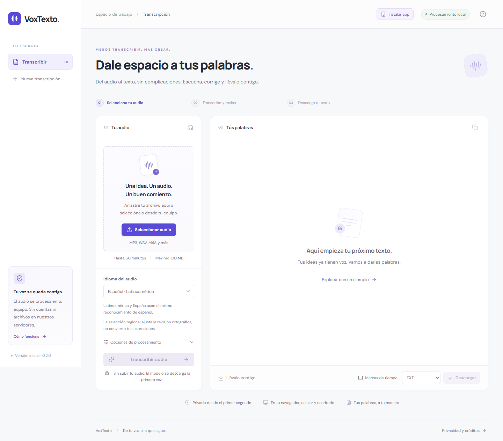

# VoxTexto

Versión 0.3.0. Configuración de publicación para `https://voztexto.com` (dominio de destino; despliegue público no verificado), con portada y guías estáticas, herramienta en `/app/`, sitemap y robots. La detección de idioma y la web instalable se conservan.

**Dale espacio a tus palabras.** Una aplicación de transcripción local para convertir audio en texto, revisarlo y descargarlo. Interfaz y lógica de producto propias; reconocimiento de voz basado en Whisper Base mediante Transformers.js.



## Inicio rápido

Requiere Node.js 24 y npm. Desde una copia del repositorio:

```sh
git clone https://github.com/wasatnight/voxtexto.git
cd voxtexto
npm ci
npm run dev
```

Abre `http://127.0.0.1:1420`. La primera transcripción descarga el modelo y puede consumir varios cientos de MB; los pesos, las dependencias y los archivos de compilación no se guardan en Git.

Para contribuir, consulta [CONTRIBUTING.md](CONTRIBUTING.md). Las comprobaciones de esta publicación se registran en [docs/REVISION-2026-10-21.md](docs/REVISION-2026-10-21.md). Los informes anteriores describen su entorno y fecha, no nuevas ejecuciones.

## Qué incluye esta versión

- Selección o arrastre de audio; validación de **60 minutos y 100 MB** antes de descargar el modelo.
- Reconocimiento multilingüe, detección automática propia y selección manual de 99 idiomas compatibles con Whisper Base. La precisión varía por idioma; no se promete compatibilidad con todos los idiomas existentes.
- Español latinoamericano y español de España como preferencias regionales: comparten reconocimiento y se indica `lang` al editor para orientar la revisión ortográfica del navegador. No son modelos dialectales diferentes ni convierten vocabulario.
- Indicación del idioma realmente utilizado para generar cada transcripción, independiente del selector de la siguiente ejecución.
- Instalación desde navegadores compatibles en Android, iPhone/iPad y escritorio. Información de ayuda presentada por párrafos.
- Inferencia en un Web Worker: GPU cuando está disponible, con alternativa CPU si falla la inicialización de GPU. Modo CPU seleccionable.
- Cancelación mediante terminación del Worker. El modelo ya descargado puede seguir en la caché del navegador.
- Texto editable por segmentos, marcas de tiempo, reproducción, salto al segmento y velocidad ajustable.
- Exportaciones locales a TXT UTF-8, DOCX y PDF. Copiado al portapapeles.
- Diseño adaptable, navegación con teclado, avisos accesibles y ejemplo de edición identificado explícitamente como demostración.
- Contenedor Tauri para Windows y flujos de GitHub Actions para comprobar la web y construir un instalador bajo demanda.

## Privacidad

- El código de VoxTexto no envía audio ni transcripciones a un servidor. Los datos de la sesión se mantienen en memoria; los archivos originales siguen en el dispositivo.
- No hay cuenta, base de datos, analítica ni historial de grabaciones. Las fuentes de la interfaz se distribuyen con la aplicación.
- Sí hay solicitudes de descarga a Hugging Face y sus CDN para obtener el modelo; esos proveedores reciben metadatos normales de conexión, como la dirección IP. No reciben el audio por parte de esta app.
- Se conserva la interfaz y sus recursos estáticos en una caché propia mediante un service worker de producción. Puede conservarse el modelo en la caché independiente de Transformers.js. No se guardan audios ni transcripciones en estas cachés.
- La interfaz puede abrirse sin internet tras la primera carga. Transcribir sin conexión requiere haber descargado previamente el modelo y los componentes del motor que correspondan; el navegador puede eliminar cachés cuando necesite espacio.
- Al cerrar o reiniciar se pierde el texto de la sesión. Descárgalo para conservarlo. La app intenta advertir antes de cerrar si hay texto generado o editado.
- La eliminación de referencias en JavaScript no equivale a un borrado forense de memoria o cachés administradas por el sistema.

## Formatos y límites

La compatibilidad de MP3, WAV, M4A, OGG, Opus, FLAC, AAC y WebM depende de los códecs del navegador o WebView. WAV y MP3 son las primeras opciones para resolver problemas.

Los 60 minutos son un límite de admisión, **no una garantía de velocidad**. El audio se decodifica a PCM mono de 16 kHz y se procesa en ventanas de 30 segundos con solapamiento. La decodificación lee el archivo completo y puede usar bastante memoria. La validación del límite de una hora está probada; no se ha realizado una transcripción completa de una hora en esta entrega.

El porcentaje de transcripción cuenta ventanas completadas. La descarga del modelo muestra progreso por archivo. No se estima un tiempo restante artificial.

TXT y DOCX conservan Unicode. Para alfabetos cubiertos por Roboto, el PDF tiene texto seleccionable. Para otros alfabetos, la app renderiza las páginas con las fuentes de sistema y las incorpora como imágenes para evitar glifos ausentes. En ese caso el PDF no tiene texto seleccionable y depende de las fuentes instaladas; Word/TXT son preferibles para editar, buscar o usar lectores de pantalla.

La app **transcribe en el idioma original**. No traduce entre idiomas, no resume ni identifica hablantes en esta versión. La detección automática se aplica al audio, sin prometer cambios de idioma correctos dentro de una misma grabación.

### Cómo se corrigió la detección automática

Transformers.js 4.3.1 usa inglés por defecto cuando no se proporciona idioma a Whisper. La versión 0.1.0 omitía el idioma y lo presentaba erróneamente como detección automática. Era un fallo de integración de VoxTexto, no del idioma de Windows.

La versión 0.2.0 genera una predicción del token de idioma desde `<|startoftranscript|>`, restringe la elección a los idiomas del modelo y combina hasta tres muestras de audio. Después pasa explícitamente el idioma identificado a la transcripción. La app marca resultados de detección dudosos y permite escoger un idioma manualmente; estas probabilidades no son una medición de certeza lingüística calibrada.

### Instalar en el celular

La app incluye un manifiesto web, iconos para Android/iOS y un service worker. En Chrome/Edge compatibles, **Instalar app** abre el aviso del navegador cuando está disponible. En otros casos presenta instrucciones: menú de instalación en Android o **Compartir → Agregar a pantalla de inicio** en Safari de iPhone/iPad.

Para probarla desde un teléfono necesitas una dirección pública HTTPS. `127.0.0.1` apunta al propio dispositivo y no permite acceder desde el teléfono al servidor de tu PC. La instalación en teléfonos físicos todavía no se ha verificado; sí se probaron el diseño móvil, los recursos del manifiesto y la apertura de la interfaz sin conexión en Chrome de escritorio.

El procesamiento puede detenerse si el sistema suspende la app. Mantén la pantalla y la app activas para archivos largos; instalar la PWA no aporta más RAM ni procesamiento en segundo plano garantizado.

El service worker no se registra en desarrollo ni dentro de Tauri. Una actualización espera su turno sin forzar recargas que destruyan texto no descargado.

## Validación

```sh
npm test
npm run test:e2e
npm run build
npm audit
```

Las pruebas de navegador usan Chrome instalado. Para usar Chromium administrado por Playwright, cambia `channel` en `playwright.config.ts` e instala el navegador correspondiente.

La prueba de voz real es opcional porque descarga el modelo y un audio público de ejemplo de la documentación de Transformers.js:

```powershell
$env:REAL_ASR = '1'
npm run test:e2e -- -g "real speech"
```

El entorno Windows restringido de la primera entrega cancela el guardado de descargas gestionado por Chrome. La prueba de exportación comprueba el Blob real suministrado al enlace, su nombre y sus bytes, y escribe los archivos desde el runner. No se presenta como verificación del diálogo de guardado del sistema.

Para probar la PWA, ejecuta `npm run build` y `npm run preview -- --port 1423`. Las pruebas opcionales aceptan `VOX_TEST_URL` para apuntar al servidor de producción, `PWA_TEST=1` para comprobar la interfaz sin conexión y `SPANISH_FIXTURE` con la ruta a una muestra pública de voz española para comprobar la detección en un navegador en inglés.

## Estructura

```text
src/
  App.tsx                    Flujo, edición y reproductor
  transcription.worker.ts    Descarga del modelo e inferencia local
  lib/audio.ts               Metadatos, decodificación y mezcla mono
  lib/transcript.ts          Validación y formato de texto
  lib/export.ts              Generación y guardado de documentos
  lib/pdf-pages.ts           PDF con fuentes del sistema
src-tauri/                   Contenedor y permisos de escritorio
tests/e2e/                   Pruebas de flujos en navegador
.github/workflows/           Comprobaciones y compilación Windows
```

## Publicar la web y el código

`npm run build` genera un sitio estático en `dist/`. Puede alojarse en un servicio estático que sirva correctamente JavaScript y WebAssembly por HTTPS. `base: './'` permite ubicarlo en una subcarpeta. No se incluye un backend ni claves API.

Antes de anunciar una versión estable: validar la compilación Windows, probar otros navegadores y GPU reales, medir consumo y tiempo con archivos largos y revisar la exportación en los alfabetos que quieras destacar. Código del proyecto: [wasatnight/voxtexto](https://github.com/wasatnight/voxtexto). El repositorio publica código fuente; no implica un despliegue web ni un instalador validado.

## Licencia y créditos

Código de la aplicación bajo [MIT](LICENSE). [Créditos y licencias de terceros](THIRD_PARTY_NOTICES.md). VoxTexto no es un producto oficial de OpenAI ni de Hugging Face y no atribuye como propio el entrenamiento de Whisper.

El análisis de una posible integración de reuniones está en [REUNIONES.md](docs/REUNIONES.md); esta versión no incluye un bot de reuniones ni comienza grabaciones.
